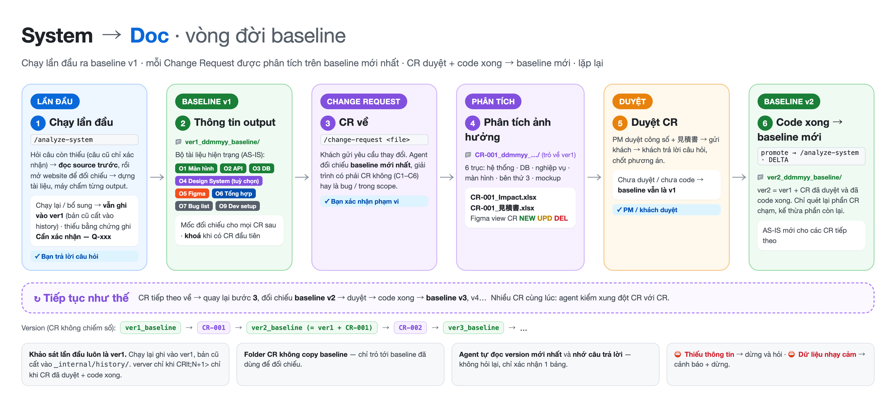

# system-to-doc — BA Kit

> Nhận một **hệ thống đã có sẵn** (website đang chạy · source code · database · Figma) → AI tự khảo sát → dựng **bộ tài liệu baseline có version**. Về sau mỗi khi khách gửi **yêu cầu thay đổi (CR)**, AI đối chiếu baseline để trả lời CR ảnh hưởng tới đâu.
>
> Hướng dẫn có hình: [`docs/Hướng dẫn sử dụng System to Doc.docx`](docs/)

---

## Hai luồng

| | Luồng 1 — Baseline | Luồng 2 — Change Request |
|---|---|---|
| Khi nào | Lần đầu nhận dự án · hệ thống đã đổi nhiều | Khách gửi yêu cầu thay đổi |
| Lệnh | `/analyze-system` | `/change-request <file / link / nội dung>` |
| Model | Opus (tự chọn khi gõ lệnh) | Opus |
| Đọc | Website · Source · DB · Figma | Baseline mới nhất + nội dung CR |
| Ra | `outputs/ver1_<DDMMYY>_<tên>/` — 9 output (chạy lại vẫn ghi vào ver1) | `outputs/CR-<id>_<DDMMYY>_<tên>/` — impact 6 trục |

---

## Chuẩn bị (1 lần)

Copy toàn bộ folder `system-to-doc` vào folder dự án → mở bằng Claude Code. **Không cần cài gì thêm.**

> 🔧 **Kit tự lo môi trường.** Khi chạy `/analyze-system` hoặc `/change-request`, AI tự kiểm tra và **tự cài** những gì còn thiếu: thư viện Python, Playwright + trình duyệt (khi quét website), kết nối Figma MCP (khi vẽ Figma). Việc duy nhất bạn có thể được nhờ: gõ `/mcp` → chọn **figma** → **Authenticate** để đăng nhập Figma (tài khoản có quyền EDIT).

Kit **có sẵn các folder để bạn bỏ file vào** — AI tự tìm ở đó trước khi hỏi lại đường dẫn:

```
my-project/
├── CLAUDE.md · POLICIES.md · AGENTS.md · templates/ · .claude/    ← kit (không sửa)
├── inputs/                      ← có sẵn, mỗi folder con có README.md hướng dẫn
│   ├── repo/                    ← source code: mỗi repo 1 folder con (web-fe/, api/, batch/…)
│   ├── db/                      ← schema.sql — dump CHỈ CẤU TRÚC, không dữ liệu
│   └── cr/                      ← file yêu cầu thay đổi của khách (Luồng 2)
├── .auth/                       ← tài khoản test + phiên đăng nhập — KHÔNG commit
│   ├── credentials.example.env  ← mẫu; copy thành credentials.local.env rồi điền
│   └── credentials.local.env    ← bạn điền; script đọc, AI không đọc
└── outputs/                     ← AI tự tạo: ver1_… / CR-… / ver2_… + _project/ (câu trả lời đã nhớ)
```

| Bạn có | Bỏ vào đâu |
|---|---|
| Source code | `inputs/repo/<tên-repo>/` (không có `.env`, key, `node_modules/`) |
| File DB | `inputs/db/schema.sql` — `mysqldump --no-data` / `pg_dump --schema-only` |
| Tài khoản test website | `.auth/credentials.local.env` (xem bên dưới) |
| Yêu cầu thay đổi | `inputs/cr/` |
| Website · Figma | Chỉ cần URL — AI hỏi khi chạy |

Nội dung `inputs/repo|db|cr/` và `.auth/` đã `.gitignore` — không bị commit.

---

## Luồng 1 — chạy lần đầu

```bash
cd my-project && claude
/analyze-system
```

AI **đọc source code trước**, rồi mới mở website. AI sẽ hỏi (chọn đáp án hoặc gõ vào ô *Other*; mỗi lượt gom tối đa 4 câu cùng chủ đề):

| Nhóm | AI hỏi | Chuẩn bị sẵn |
|---|---|---|
| **Website** | Bao nhiêu site · URL · staging/production · tài khoản role nào · **ai cấp, có được phép dùng để quét không** · chỉ ĐỌC hay được CREATE/UPDATE · vùng cấm | URL, tài khoản **test** |
| **Source code** | Repo nào (AI tự liệt kê từ `inputs/repo/`) · FE/BE · repo FE thuộc website nào | Repo đã bỏ vào `inputs/repo/` |
| **Database** *(tuỳ chọn)* | Có file schema / quyền đọc DB / chỉ có migration / không có | File `.sql` chỉ cấu trúc trong `inputs/db/` |
| **Figma** *(tuỳ chọn)* | Link design hiện tại · **link file để vẽ flow** | Link `figma.com/design/...` |
| Khác | Có làm bug list không · ngôn ngữ · nguồn có dữ liệu thật không | |

> ⚠️ **Mật khẩu không gõ vào chat.**
> - **Môi trường kiểm thử (dev / staging, tài khoản test):** điền sẵn `.auth/credentials.local.env` (copy từ `credentials.example.env`; chưa có thì AI tạo file với chỗ trống) → bạn mở file, điền URL, tài khoản (+ Basic Auth nếu có) và ghi `ENV=TEST` → AI cho Playwright tự đăng nhập và quét toàn bộ màn, **tự đăng nhập lại** nếu app đá phiên. AI không đọc file này; script từ chối nếu không phải `TEST`.
> - **Production / chưa chắc:** AI mở trình duyệt, bạn tự đăng nhập.
> - `.auth/` không commit, không nằm trong output. Xong khảo sát thì xoá file và đổi mật khẩu test.
> ⚠️ Mặc định AI **chỉ đọc** — mọi thao tác ghi bị chặn ở tầng mạng.
> Thiếu thứ gì (không có DB, không có Figma…) → AI ghi lại và **chạy tiếp** phần còn lại.

> 🧠 **AI nhớ câu trả lời.** Lần chạy sau AI không hỏi lại — chỉ in 1 bảng *"Tôi đang dùng các thông tin sau — có gì đổi không?"*. Riêng 4 câu an toàn (website thử nghiệm hay thật · tài khoản có được phép quét · mức thao tác · có dữ liệu thật không) luôn được hỏi lại gọn *"vẫn như lần trước chứ?"*. Chưa có thông tin (ví dụ chưa có link Figma) → chọn **"Chưa có — chạy v1 trước, bổ sung sau"**; khi bổ sung, AI cập nhật lại ver1.
> 🔐 **Không đăng nhập được?** AI không thử mãi: sau 2 lần sẽ mở trình duyệt và nhờ bạn **đăng nhập tay**, xong trả lời "xong".

Sau khi đọc code, AI in **bảng tổng hợp** kèm **các quyết định lớn có đề xuất** (ví dụ "2 website khác nhau về cỡ chữ, bo góc nút → đề xuất 2 bộ quy chuẩn giao diện riêng", "đồng ý vẽ sơ đồ database / API lên Figma?") → bạn trả lời `OK` → AI khảo sát và sinh output. Phát hiện dữ liệu nhạy cảm (`.env`, key, dump có dữ liệu thật…) → AI **cảnh báo và dừng** chờ bạn xử lý.

### Output Luồng 1

| # | Output | File trong `outputs/ver<N>_.../` |
|---|---|---|
| **O1** | **Danh sách màn hình theo website** — tổng số màn, item từng màn, xử lý, **API mỗi nút gọi** (cột "API gọi"), lỗi hiển thị, liên kết giữa các màn (template Basic Design công ty; đọc code trước rồi mới mở website) | `01_Screens/BasicDesign_WEB-01_ver<N>.xlsx` (1 file / website) |
| **O2** | **API Documentation** — mọi API theo group (+ batch): làm gì, method, request, response; sheet tổng hợp có link tới từng API | `02_API/API_Doc_….xlsx` |
| **O3** | **Database Documentation** — tổng quan bảng, quan hệ, từng bảng: field · kiểu · format · giới hạn · maxlength · mục đích · ERD | `03_DB/DB_Doc_….xlsx` · `03_DB/ERD_….png` |
| **O4** | *(tuỳ chọn — không chạy thì bỏ qua)* **Design System** hệ thống cũ (từ website / Figma + source) — **cùng chuẩn với `designer-kit`** và format artifact **Design System** của claude.ai: brand book, màu theo theme, thang chữ, spacing/radius/shadow/size, component có preview, logo/icon, cover; token đặt tên vai trò chuẩn, phần không quan sát được ghi TBD. Nhiều website: chỉ khác màu → 1 Design System mỗi site 1 theme; khác cả phong cách → mỗi website 1 Design System riêng. Đồng ý thì publish thành link private | `04_DesignSystem/` (`STATUS.md` + `project/`) |
| **O5** | **Figma flow** — Output 1 Flow tổng quan + Output 2 Screen flow | link trong `05_Figma/figma-links.md` |
| **O6** | **Tài liệu tổng hợp** — hệ thống làm gì, **luồng nghiệp vụ chính** (bước đánh số), trạng thái đối tượng chính; màn hình / API / database chỉ 1 bảng tổng (sơ đồ database là link Figma) | `06_Overview/Overview_….docx` |
| **O7** | **Bug list hiện trạng** — 1 sheet; đọc code và mở thử website; chỉ lỗi **làm người dùng thao tác không được hoặc sai**, mức **High / Urgent** *(nếu chọn)* | `07_BugList/BugList_….xlsx` |
| **O9** | **Hướng dẫn chạy local** — cho dev mới: lệnh cài / chạy, database local, **tên** các key cấu hình (không có giá trị), môi trường, pipeline, lịch batch | `09_DevSetup/DevSetup_….md` |
| — | **Mục lục version** — mọi output, số lượng, kết quả kiểm tra | `README.md` |

Mọi dòng trong tài liệu gắn với bằng chứng (ảnh chụp, dòng code, schema). Không có bằng chứng → ghi "Cần xác nhận — Q-xxx" (bản tiếng Nhật 「要確認 — Q-xxx」), **không viết đại cho đẹp**. Danh sách điểm chưa chắc AI liệt kê ở cuối phiên chạy.

---

## Luồng 2 — khi có 1 yêu cầu thay đổi

**Bước 1 — đưa yêu cầu vào** (1 trong 3 cách):

| Cách | Làm gì |
|---|---|
| File *(khuyến nghị)* | Bỏ file (`.docx` `.pdf` `.xlsx` `.md` ảnh chụp) vào `inputs/cr/` → `/change-request inputs/cr/<tên-file>` |
| Dán trực tiếp | `/change-request` rồi dán nội dung yêu cầu |
| Link | `/change-request <link Backlog / Drive / Figma>` — không đọc được link thì AI nhờ bạn tải file về `inputs/cr/` |

**Bước 2 — AI làm:** tìm baseline mới nhất → hỏi xác nhận + hỏi chỗ chưa rõ → phân tích **6 trục**:

| Trục | Trả lời |
|---|---|
| Hệ thống | CR tác động tới site / module / repo / batch nào |
| Database | Thêm gì? Xung đột với cái cũ không? |
| Nghiệp vụ | Sửa gì? Ảnh hưởng nghiệp vụ hiện tại không? |
| Màn hình | Thêm / sửa / xoá màn nào? Ảnh hưởng màn hiện tại không? |
| Bên thứ 3 | Thêm liên kết nào? Ảnh hưởng liên kết hiện tại không? |
| Mockup | Màn mới có nhất quán với Design System cũ không? |

**Output Luồng 2** (`outputs/CR-<id>_<DDMMYY>_<tên>/`):
- `CR-<id>_Impact.xlsx` — **7 sheet**, gửi khách được:
  - `Summary`: chỉ cơ bản — **công số thay đổi** (実装 MD · 総工数 人日 · 人月, link sang Estimation; tách 最小改修案 / 拡張案) · **số đối tượng thay đổi** (màn hình / API / bảng DB / cột DB / rule / liên kết ngoài / mockup) × thêm / sửa / xoá / bị ảnh hưởng · link tới từng sheet
  - `Estimation`: đúng khung 見積書 của công ty (`templates/template_estimation.xlsx`, bóc bằng `extract-estimation-template.py`) — 1 dòng / hạng mục, 要件定義 / UI・UX / テスト / 管理 tính bằng hệ số của template
  - `Screen` · `API` · `Database` · `Figma`: từng hạng mục của trục — loại · **vì sao phải sửa** · ảnh hưởng tới cái đang có · xung đột · rủi ro · **MD**
  - `Q&A`: **vì sao đây là CR** (C1–C6) · câu hỏi cần khách trả lời · trục không ảnh hưởng · mục không thuộc CR
- Figma **view CR mới** (`.claude/sys-agent/figma/cr-view.md`) — CR-1 Flow theo khung Output 1 · CR-2 Screen Flow theo khung Output 2 (mũi tên thật) · CR Change Table = **thống kê** · CR-3 **màn đề xuất** dựng từ Design System baseline (AI đọc Design System trước, hỏi phạm vi) — chỉ phần thay đổi + phần bị ảnh hưởng, không vẽ đè bản cũ.

> MD = đơn giá trong `.claude/config/md-unit-rates.json` × số lượng (AI chỉ chọn loại hạng mục, không tự gõ số). Bảng đơn giá đang **DRAFT** — PM / Tech Lead duyệt rồi đổi `status` thành `APPROVED`.

CR đã được **duyệt và làm xong** trong hệ thống → nói *"CR-001 đã duyệt, đã code xong"* (hoặc chạy `/analyze-system`) — AI xác nhận lại với bạn rồi mới tạo **baseline mới** (ver2) = ver1 + CR đó.

---

## Version



```
outputs/
├── ver1_011026_baseline/              Luồng 1 — khảo sát lần đầu; chạy lại / bổ sung vẫn ghi vào đây
│   └── _internal/history/20261005-1030/   bản cũ của các file bị ghi đè khi chạy lại
├── CR-001_151026_them-coupon/         Luồng 2 — trỏ về ver1 (từ lúc này ver1 bị khoá)
└── ver2_251026_baseline/              baseline mới = ver1 + CR-001 (chỉ tạo khi CR-001 đã duyệt + đã code xong)
```
**AI tự quản version — bạn không phải làm gì:**
- Khảo sát lần đầu luôn là **ver1**. Chạy lại `/analyze-system` (thêm nguồn, thêm output, sửa theo góp ý) → AI **ghi vào ver1**, trước khi ghi đè thì cất bản cũ vào `_internal/history/<ngày-giờ>/`.
- Có CR đầu tiên → ver1 **bị khoá** (không ghi đè nữa, để CR luôn đối chiếu đúng bản gốc).
- CR đã duyệt **và** đã code xong → AI hỏi xác nhận rồi tạo **ver2** = ver1 + CR đó. ver3, ver4… cũng chỉ sinh theo cách này.
- Mỗi lần chạy, AI tự đọc **version mới nhất** (baseline hiện hành, CR đang mở, góp ý chưa xử lý) — không cần chỉ folder. Muốn góp ý → **nói thẳng trong chat**.
- Folder cũ dạng `ver<N>_…_CR-…` vẫn đọc được bình thường.

---

## Kit cam kết

| Cam kết | Cách thực thi |
|---|---|
| **Không bịa** | Mọi khẳng định gắn bằng chứng; thiếu thì ghi "Cần xác nhận — Q-xxx" + câu hỏi |
| **Không phá hệ thống** | Mặc định chỉ đọc; gặp nút xoá/thanh toán vẫn dừng hỏi; không bao giờ kết nối DB của khách |
| **Không làm lộ dữ liệu** | Quét nhạy cảm trước khi đọc, hook chặn PII trước khi ghi/đẩy lên Figma, mật khẩu không bao giờ vào file |
| **Tự chấm, không tự khen** | Mỗi output qua script kiểm tra, in số thật `N checks · X PASS · 0 FAIL` |
