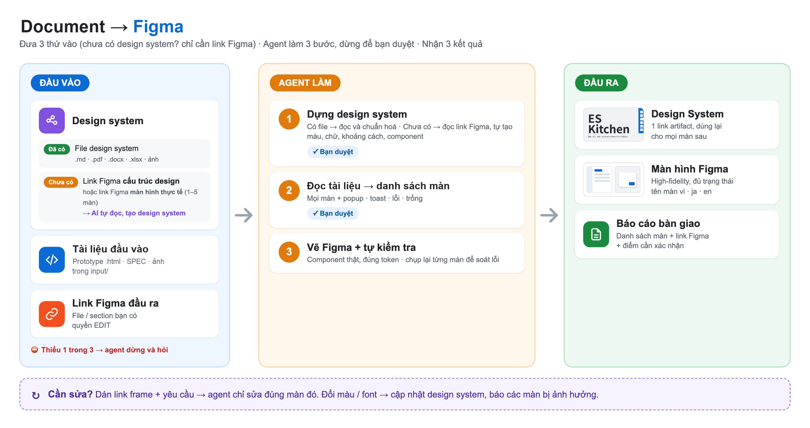

# document-to-figma — Designer Kit Feature

Chuyển **tài liệu** (HTML prototype · SPEC · Basic Design · ảnh màn hình…) thành **Figma high-fidelity** đúng **design system của dự án bạn**. Dùng được cho mọi dự án.



## 1. Kết nối Figma MCP (làm 1 lần)

Chọn **1** trong 2 cách:

- **A — Connector claude.ai (khuyến nghị):** claude.ai → *Settings → Connectors* → bật **Figma** → đăng nhập Figma. Mở Claude Code bằng cùng tài khoản là dùng được.
- **B — `.mcp.json` có sẵn trong kit:** mở Claude Code tại folder này → gõ `/mcp` → chọn **figma** → **Authenticate** → Allow trên trình duyệt.

Kiểm tra: gõ `/mcp` → thấy **figma** ở trạng thái connected. Tài khoản Figma cần quyền **EDIT** file đầu ra.

## 2. Chuẩn bị

| Cần có | Ghi chú |
|---|---|
| **Design system** của dự án | Link Figma (Foundations / Component Library) · tài liệu guideline · link artifact Design System · codebase · hoặc 1–5 màn Figma đã duyệt. Agent phân tích → dựng **Design System artifact** (claude.ai) để bạn duyệt. **Chưa có → chọn dùng Base Design System chuẩn UI Nhật có sẵn trong kit (tạm, chờ duyệt), hoặc agent dừng.** |
| **Tài liệu** đầu vào | Copy vào `input/`: prototype `.html` · SPEC / Basic Design `.md` `.docx` `.xlsx` `.pdf` · ảnh màn hình (dữ liệu mẫu) · hoặc link Figma wireframe |
| **Link Figma đầu ra** | File / page / section bạn có quyền EDIT |

## 3. Sử dụng

1. Mở Claude Code tại folder `document-to-figma`.
2. Dán prompt:
   ```
   Hãy là Designer, chuyển tài liệu trong folder input sang Figma
   ```
   hoặc gõ `/document-to-figma [document-path] [figma-output-url] [design-system-url]` (3 tham số đều tuỳ chọn)
3. Trả lời các hộp chọn — thiếu gì agent hỏi, không tự đoán:
   - **Design system:** nguồn ở đâu? Đã có **link artifact Design System** → agent dùng luôn, không tạo mới. Link Figma / tài liệu → agent phân tích, dựng Design System artifact; thiếu thì gửi 1–5 màn / link Figma để agent đo, bổ sung
   - **Tài liệu & phạm vi:** vẽ toàn bộ · chọn màn · chỉ phân tích · 1 luồng
   - **Link Figma đầu ra** · tên output
   - **Platform** · **ngôn ngữ tên** màn (đề xuất vi + ja + en)
4. Duyệt Design System artifact (lần đầu, mở link để xem token / component / preview) và danh sách màn → agent vẽ Figma.
5. Agent dựng thêm frame **Screen Index** trên Figma (bảng mô tả đã vẽ gì, bấm tên màn để nhảy tới frame).
6. Agent dựng thêm **Field Description Table** (mô tả từng trường, JP|VI, lấy nguyên văn từ tài liệu — không suy diễn).
7. Kết quả: frame trong Figma + Screen Index + Field Table + `output/<feature>/figma-screens.md` + `screen-index.md`.

## Lưu ý

- Màu, font, component lấy từ Design System artifact (`design-system/`) — không copy CSS của prototype / style trong tài liệu.
- Tên đa ngôn ngữ được xuống dòng, không bị cắt chữ.
- Không đưa dữ liệu cá nhân thật vào Figma (hook H06 chặn khi phát hiện).
- Agent không sửa tài liệu gốc, không commit / push.

📘 Hướng dẫn chi tiết có hình: `docs/Hướng dẫn sử dụng Document to Figma.docx`
