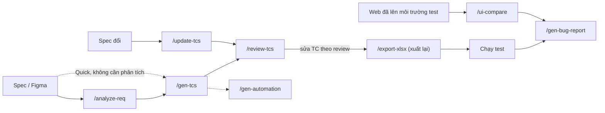

# Kit 6: qc-kit-agent

> **QC Testing Specialist** — Pipeline sinh manual test cases theo RBT, cập nhật khi spec đổi, so UI với design và sinh automation Playwright.

Hướng dẫn đầy đủ nằm ở `qc-kit-agent/README.md` trong repo. Trang này là bản tóm tắt.

---

## Mục đích

`qc-kit-agent` cung cấp quy trình **Risk-Based Testing (RBT)**:

- Phân tích requirement: câu hỏi Q&A cho BA, chỗ spec lệch design, Acceptance Criteria
- Sinh manual test cases chi tiết, có self-check
- Review bộ test cases
- Cập nhật test cases khi spec đổi
- Xuất Excel theo template công ty
- So UI web thật với design Figma
- Sinh và chạy Playwright automation
- Chuẩn hóa bug reports

---

## Quy trình



Không có bước plan riêng: `/gen-tcs` tự dựng cấu trúc Screen/Component, Risk Level, Permission Matrix và luồng E2E trước khi sinh test cases.

---

## Commands

| Command | Input | Output |
|---------|-------|--------|
| `/analyze-req` | Spec (file, Google Drive/Docs, Backlog, text), link Figma nếu có | `[module]-analysis-vN.md` |
| `/gen-tcs` | `[module]-analysis-vN.md`; chưa có thì chọn Full (phân tích trước) hoặc Quick (sinh thẳng từ spec) | `[module]-testcases-vN.md`, tự xuất `.xlsx` nếu chưa có |
| `/review-tcs` | `[module]-testcases-vN.md` | `[module]-review-vN.md` và `[module]-review-detail-vN.md`. Không tự sửa TC |
| `/export-xlsx` | File `.md` hoặc tên module, `web` hoặc `app` | `.xlsx` cùng tên, đúng template, giữ dropdown. File đích đã có thì hỏi trước khi ghi đè |
| `/update-tcs` | File TC (`.xlsx` đang chạy hoặc `.md`) và spec mới | File TC version mới kèm Changelog, cập nhật analysis. File cũ giữ nguyên |
| `/ui-compare` | Link web và link Figma có `node-id` | `[module]-uicompare-vN.md` và `.html`: danh sách nghi bug UI kèm ảnh |
| `/gen-automation` | `[module]-testcases-vN.md` | `automation/` và `[module]-automation-report-vN.md` |
| `/gen-bug-report` | Mô tả lỗi | Bug report sẵn để dán vào Backlog |

```bash
/analyze-req testing/login/spec.md
/gen-tcs login
/review-tcs login
/export-xlsx login web
```

**Lưu ý:**

- `/review-tcs` chạy script kiểm tra tự động, rồi review bằng hai agent.
- `/gen-automation` khảo sát DOM thật bằng Playwright MCP. Lỗi phía script được tự sửa tối đa 2 vòng; assertion fail được báo là nghi bug.
- Mọi dòng trong báo cáo `/ui-compare` là nghi bug, QC xác nhận rồi mới viết bug report.

---

## Quy ước file

Mọi file của một module nằm trong `testing/[module]/`. `N` là số lần spec đổi: `/update-tcs` tạo version mới và giữ nguyên version cũ.

---

## Cấu trúc kit

```
qc-kit-agent/
├── README.md
├── CLAUDE.md                  ← Thông tin project, điền 1 lần
├── .mcp.json                  ← MCP server: playwright, figma-console
├── template/                  ← Excel TC templates (Web/App V3.0)
└── .claude/
    ├── commands/              ← 8 commands ở bảng trên
    ├── scripts/
    │   ├── md_to_xlsx.py      ← TC .md → .xlsx
    │   ├── xlsx_tcs.py        ← Đọc/ghi file TC cho /update-tcs
    │   ├── module_files.py    ← Tìm và tính version file
    │   ├── review_checks.py   ← Kiểm tra tự động cho /review-tcs
    │   └── ui_compare/        ← Script Node cho /ui-compare
    └── skills/
        ├── rbt_manual_testing/
        ├── requirements_analyzer/
        ├── testing_dimensions/
        ├── component_checklist/
        ├── jp_validation/
        ├── automation_engineer/
        ├── bug_reporter/
        ├── ui_compare/
        └── archify/           ← Vẽ diagram cho analysis
```

---

## Cài đặt

Cần có Claude Code, Python 3 với `openpyxl`, Node.js 18 trở lên (phần vẽ diagram cần thêm Chrome).

Copy `.claude`, `template`, `CLAUDE.md` và `.mcp.json` từ kit ra root project. Project đã có sẵn file nào thì **gộp nội dung, không ghi đè**.

Dùng `/ui-compare` thì cài thêm một lần:

```bash
cd .claude/scripts/ui_compare && npm install && npx playwright install chromium
```

Cách kết nối Figma: xem `qc-kit-agent/README.md`.
