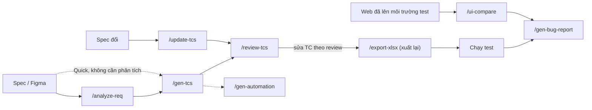

# QC Kit Agent

Bộ commands & skills hỗ trợ QC sinh manual test cases theo quy trình Risk-Based Testing (RBT) và sinh automation script Playwright từ test cases đã có.

---

## Cài đặt vào project

**Cần có trước:**

- Claude Code.
- Python 3 và `openpyxl` (`pip3 install openpyxl`).
- Node.js 18 trở lên (cho MCP server, `/ui-compare` và phần vẽ diagram; phần vẽ diagram cần thêm Chrome).

Copy 4 thứ từ kit ra **root project**: `.claude`, `template`, `CLAUDE.md`, `.mcp.json`.

- Project đã có sẵn `.claude`, `CLAUDE.md` hoặc `.mcp.json` thì **gộp nội dung, không ghi đè**.
- `.mcp.json` khai báo MCP server `playwright` và `figma-console`; chấp nhận server khi Claude Code hỏi.
- Giữ `CLAUDE.md` dưới 20 dòng; chỉ ghi thông tin áp dụng cho cả project.
- Dùng `/ui-compare`: chạy thêm lệnh cài một lần ở mục [So sánh UI với design](#so-sánh-ui-với-design) (không copy `node_modules` và `.auth/`, đã có `.gitignore`).
- Trong **root project** tạo thêm folder `testing` 
- Tiếp tục tạo folder con `module` trong `testing`
  → xem cấu trúc folder dự án mẫu như dưới

---

## Cấu trúc folder dự án

```
project-example/
├── .claude/                 # commands, scripts, skills copy từ kit
│   ├── commands/
│   ├── scripts/
│   └── skills/
├── template/                # template xlsx Web/App
│   ├── [Tên dự án]_[Tên module]_Testcase_ForWeb_V3.0.xlsx
│   └── [Tên dự án]_[Tên module]_Testcase_ForApp_V3.0.xlsx
├── testing/                 # member tự tạo
│   ├── [module-example]/
│   │   ├── spec.md          # member tự thêm: spec của module
│   │   ├── [...]            # member tự thêm: các documents khác của module
│   │   ├── [module-example]-analysis-v1.md   # output của /analyze-req (v2, v3... khi spec đổi)
│   │   ├── [module-example]-testcases-v1.md  # output của /gen-tcs
│   │   └── [module-example]-testcases-v1.xlsx  # output của /export-xlsx
│   ├── [module-A]/
│   └── [module-B]/
├── .mcp.json                # cấu hình MCP server, copy từ kit
└── CLAUDE.md                # thông tin chung của project — điền 1 lần
```

---

## Hướng dẫn chạy workflow
- **Gọi workflow**: 
  - gõ `tên command` 
  hoặc 
  - dùng `slash command (/)`: https://drive.google.com/file/d/1gwQKz1Yi5zu04OOeeyw98rPMqTQhQLwA/view?usp=drive_link
- **Nạp input**: 
  - `@file-name` : https://drive.google.com/file/d/1JrI5GpRJJgNIE4tqpL50qw8LW5_Ou_Ny/view?usp=drive_link
  hoặc 
  - `path-name của file` : https://drive.google.com/file/d/1aHpTeBoHZ3jY8jxgSkcz41gBiO7t5fBe/view?usp=drive_link
- **Ví dụ 1 câu prompt mẫu**: `thực hiện /gen-tcs với input testing/login/spec.md`

---

## Pipeline sinh Test Cases



- Đường chính: **phân tích → sinh TC → review → xuất Excel → chạy test → báo bug**.
- `/gen-tcs` tự xuất xlsx nếu chưa có. Sửa TC sau đó thì chạy `/export-xlsx` để xuất lại.
- Spec đổi: `/update-tcs` tạo version mới, rồi review lại.
- `/ui-compare` chạy độc lập, khi web đã lên môi trường test.

| Command | Input | Khi nào dùng | Output |
|---------|-------|-------------|--------|
| `/analyze-req` | Requirements doc (spec/Google Drive/Docs/Figma) | Có spec mới — phân tích điểm mờ (Q&A) và mapping REQ→AC | `testing/[module]/[module]-analysis-vN.md` gồm list Q&A kèm Summary về module |
| `/gen-tcs` | `[module]-analysis-vN.md` | Sinh Test Case chi tiết (có self-check); **tự dựng cấu trúc Screen/Component, Risk Level, Permission Matrix, luồng E2E bên trong, không cần bước plan riêng** và không lưu thành file (đầu output có tóm tắt cấu trúc). Chưa có `analysis.md` → hỏi chọn **Full** (chạy `/analyze-req` rồi sinh TC) hoặc **Quick** (sinh nhanh trực tiếp từ spec, không có Q&A, Expected suy luận tag `[ASSUMED]`, cả module 1 sheet TC). Bảng TC không có cột Risk Level/Priority; cuối file có mục `## High Risk & E2E` (Bảng 1 nhóm TC high risk, Bảng 2 test E2E), export thành 1 sheet cuối workbook. | `testing/[module]/[module]-testcases-vN.md` |
| `/review-tcs` | `[module]-testcases-vN.md` (mặc định version lớn nhất) | Muốn review chéo bộ TC (với DA có >= 2 QC). Chạy kiểm máy bằng `review_checks.py`, rồi review bằng hai agent theo tiêu chí v3 (`.claude/skills/rbt_manual_testing/review_criteria.md`). Không tự sửa TC | `testing/[module]/[module]-review-vN.md` (report chính) và `[module]-review-detail-vN.md` (phụ lục bằng chứng) |
| `/export-xlsx` | file `.md` (thường là `[module]-testcases-vN.md`) | Xuất file TC ra `.xlsx` theo template Web/App của công ty (vẫn giữ nguyên công thức) | `testing/[module]/[module]-testcases-vN.xlsx` (cùng tên, đổi đuôi) |
| `/update-tcs` | `[module]-testcases-vN.md` (đang design) hoặc `.xlsx` đang chạy + spec mới | Spec thay đổi sau khi đã có TC: giữ nguyên TC không đổi (và kết quả đã chạy), sửa/xoá/thêm TC theo spec mới, ghi spec trước/sau vào Notes, tạo analysis version mới | File TC version mới (`[module]-testcases-v(N+1).md` / `.xlsx`) + Changelog; `[module]-analysis-v(N+1).md`; các file version cũ giữ nguyên |

> **Lưu ý:** các lệnh đọc design (`/analyze-req`, `/gen-tcs`, `/update-tcs`, `/ui-compare`) cần kết nối Figma trước lần chạy đầu. Xem mục [Kết nối Figma](#kết-nối-figma) bên dưới.

---

## System Model trong `analysis.md` dùng để làm gì?

`System Model` (thực thể & định danh, vòng đời/state, Actor × Action, luồng dữ liệu, giả định môi trường) là bước dựng mô hình hệ thống từ spec, **không bịa thêm**. Nó phục vụ 3 việc:

- **Cơ sở tìm lỗ hổng:** 8 Lens (state, định danh, thao tác hàng loạt, lỗi từng phần, môi trường...) được áp lên System Model chứ không áp lên từng đoạn spec. Nhờ đó Q&A hỏi vào chỗ spec không nói tới, thay vì đối chiếu tiểu tiết.
- **Chỗ bắt hiểu sai sớm:** nằm ở đầu `analysis.md` (không còn dừng chờ xác nhận trong chat). AI hiểu sai hệ thống thì Q&A và TC phía sau sai theo, nên người dùng nên đọc phần này trước khi đọc Q&A.
- **Nguồn cho các bước sau:**
  - Ma trận Actor × Action → Permission Matrix mà `/gen-tcs` dựng → mỗi ô ❌ có TC phủ
  - Vòng đời/State → TC State Transition
  - Ô `?` (spec im lặng) → Q&A và TC `[UNCONFIRMED]`

Nếu bỏ System Model thì không file nào bị lỗi định dạng, nhưng Permission Matrix và TC State Transition mất nguồn, còn Q&A quay về kiểu đối chiếu bề mặt.

---

## Quy ước tên file và version

Mọi file của module nằm trong `testing/[module]/`, **tên module = tên thư mục**:

| File | Tên |
|---|---|
| Phân tích requirement | `[module]-analysis-vN.md` |
| Review | `[module]-review-vN.md` (N = version TC được review) và `[module]-review-detail-vN.md` (phụ lục bằng chứng) |
| Automation report | `[module]-automation-report-vN.md` (N = version TC được chạy) |
| Bản chụp spec | `[module]-spec-vN.md` (do `/update-tcs` lưu) |
| Test case | `[module]-testcases-vN.md` và `[module]-testcases-vN.xlsx` (cùng tên, đổi đuôi) |
| So sánh UI với design | `[module]-uicompare-vN.md` (báo cáo) và thư mục `uicompare/vN/` (dữ liệu trung gian, ảnh); N theo version TC của module, chưa có thì v1, chạy lại cùng N thì ghi đè |
| Diagram (thử nghiệm) | `diagrams/[module]-state-vN.json` / `[module]-flow-vN.json` (nguồn) và `.html`, N trùng analysis; xem mục Diagram bên dưới |

- `N` là số lần spec đổi. `analysis-vN` và `testcases-vN` cùng N nghĩa là cùng một bản spec.
- Chạy lần đầu tạo `v1`. `/update-tcs` (spec đổi) tạo `v(N+1)` và **giữ nguyên các version cũ**. `/gen-tcs` sinh lại cùng spec thì ghi đè version hiện tại.
- Command không nêu version thì dùng **version lớn nhất**. Module làm trước quy ước này (`analysis.md`, `test-cases.md`) vẫn đọc được và tính là v1.
- `/gen-tcs` và `/update-tcs` (chạy trên md) tự export xlsx cùng tên sau khi lưu md, nếu xlsx đó chưa tồn tại (đã tồn tại, kể cả khi đã có kết quả test, thì bỏ qua, không ghi đè). `/export-xlsx` vẫn dùng khi cần xuất lại. `/update-tcs` chạy trên xlsx đang chạy thì ghi thêm md cùng version.
- Khi tải file có kết quả từ Google Sheet về, đặt vào `testing/[module]/` với **đúng tên `[module]-testcases-vN.xlsx`** (N là version đã export), thay cho bản chưa fill kết quả; đừng giữ hai bản cạnh nhau.
- Script `.claude/scripts/module_files.py` tìm version mới nhất, tính version kế tiếp, và `check` cảnh báo md/xlsx lệch version hoặc tên sai quy ước; command gọi script này, không đếm tay.

---

## Diagram cho analysis (thử nghiệm)

`/analyze-req` vẽ **Vòng đời / State** (lifecycle) và **Luồng dữ liệu** (workflow) của System Model thành diagram bằng skill `archify` (đóng gói sẵn ở `.claude/skills/archify`, cần Node >= 18 và Chrome). Link nằm ngay đầu `analysis.md`, mở file HTML bằng trình duyệt: `testing/[module]/diagrams/[module]-state-vN.html`, `[module]-flow-vN.html`.

- **Text trong `analysis.md` vẫn là bản chính** (`/gen-tcs`, `/update-tcs`, `/review-tcs` đọc text). Diagram chỉ để người đọc hình dung nhanh; lệch với text thì text đúng, báo AI vẽ lại (không sửa tay diagram).
- **xlsx không chứa diagram** (chỉ bảng/text).
- Diagram đang thử nghiệm, chưa thay text; text luôn là bản chính.
- Chạy lại cùng file phải xoá receipt `*.finalize*.json`, `*.browser-check.json`, `*.delivery.json` trong `diagrams/` trước.
- `/gen-tcs` đọc file JSON của diagram chỉ để **đối chiếu độ phủ** (mỗi chuyển trạng thái, mỗi cạnh luồng có TC chưa), không sinh TC riêng từ diagram; phần diagram mà text không nêu thì báo `Diagram lệch text`.
- `/update-tcs` tạo analysis v(N+1) thì vẽ lại diagram `v(N+1)` từ text đã sửa, diagram `vN` giữ nguyên; vẽ lỗi thì bỏ link ở đầu file và báo `Diagram chưa cập nhật`.

---

## Automation

`/gen-automation` — Sinh & chạy Playwright automation script thật từ file TC mới nhất (`[module]-testcases-vN.md`, dùng Playwright MCP để recon DOM thật), chạy test, tự sửa lỗi phía script (auto-heal tối đa 2 vòng, chỉ chạy lại TC fail); assertion fail được báo là nghi bug, không sửa. Bắt buộc phải có file TC trước khi chạy.

| Command | Input | Khi nào dùng | Output |
|---------|-------|-------------|--------|
| `/gen-automation` | `[module]-testcases-vN.md` | Đã có file TC, muốn sinh automation script chạy thật | `automation/` (pages/tests/utils) + `testing/[module]/[module]-automation-report-vN.md` (PASS / Nghi bug / Không chạy được) |

> **Lưu ý:** Playwright MCP server (`@playwright/mcp`) phải được cài global và reachable trước khi chạy lần đầu.
> Xem hướng dẫn cài đặt `playwright mcp` tại đây: https://docs.google.com/document/d/11qEffhyYP7zXdnWDAwqLTGgewIwZbxAfCwu6bFTxWPA/edit?tab=t.0

---

## Bug Report

`/gen-bug-report` — Độc lập, không nằm trong pipeline TC.

Dùng khi QC tìm được bug và muốn chuẩn hóa report trước khi submit lên Backlog. Input là mô tả lỗi tự nhiên, output là bug report đầy đủ fields (Bug Type, Severity, Priority, Steps to Reproduce).

---

## So sánh UI với design

`/ui-compare` — Độc lập, không nằm trong pipeline TC. So **design Figma** (expect) với **UI web thật** (actual) theo từng kích thước màn hình, ra danh sách **nghi bug UI**: thừa/thiếu item, vị trí, kích thước, khoảng cách, màu, chữ, viền, bo góc. So từ khung tổng thể đến chi tiết. Khách Nhật coi lệch UI như lỗi logic nên lệch đến từng pixel cũng được liệt kê. Chỉ **web** (app để sau); chưa so hover/lỗi/rỗng.

| Command | Input | Khi nào dùng | Output |
|---|---|---|---|
| `/ui-compare <link web> <link Figma> [<link Figma> ...]` | Link web và link Figma có `node-id`, **thứ tự nào cũng được**; AI tự suy ra module và kích thước | Muốn kiểm UI đã dựng có đúng design không | `testing/[module]/[module]-uicompare-vN.md` và `.html` (bản đọc, ảnh khác biệt cạnh ảnh design và web) + `testing/[module]/uicompare/vN/` (số liệu, ảnh Figma, ảnh web đã cắt, ảnh khác biệt) |
| `/ui-compare <module> --url <URL> --sizes <size>=<node Figma>[,...] [--steps ...] [--quick]` | Dạng đầy đủ, dùng khi muốn ghi đè; trộn được với dạng ngắn | Như trên | Như trên |

Câu gõ mẫu:

```
/ui-compare https://dev.example.com/login https://www.figma.com/design/<key>/<tên>?node-id=12-34
/ui-compare https://dev.example.com/login <link Figma> --quick
/ui-compare https://dev.example.com/login <link Figma> --steps "bấm tab Đăng ký"
```

- **`--quick`:** so ảnh theo khối lớn và so danh sách chữ trước, chỉ đo số ở khối có lệch; báo cáo một trang. Nhanh hơn, phù hợp lần chạy đầu, nhưng lệch 1 đến 2px và màu gần giống có thể lọt. Bỏ `--quick` khi cần đo từng phần tử.
- **`--steps`:** thao tác trước khi đo (mở tab, bấm nút, điền ô): file JSON, hoặc mô tả bằng lời trong ngoặc kép, AI tự viết file JSON.

Báo cáo chia theo **ba loại so với design: thiếu, thừa, có nhưng sai**, mỗi mục có nhãn **người xử lý** (dev, designer, BA, QC); dữ liệu động ghi riêng, không tính vào số đếm. Khác biệt đã xác minh là không nhìn thấy (ví dụ nền trắng so với trong suốt trên trang trắng) vào mục riêng `KB`, không tính là nghi bug. Mọi dòng nghi bug là **chưa xác nhận**; QC xem ảnh, xác nhận rồi mới chạy `/gen-bug-report`. Báo cáo chế độ kỹ có bảng "Phạm vi và mức độ kiểm tra" (số phép đã so, không so được, bỏ qua) do script tính.

**Cài một lần** (cần Node 18 trở lên; command không tự cài):

```
cd .claude/scripts/ui_compare && npm install && npx playwright install chromium
```

(Nếu `npx` không tìm thấy Chromium: `node node_modules/playwright/cli.js install chromium` trong cùng thư mục.)

**Figma:** xem mục [Kết nối Figma](#kết-nối-figma); `/ui-compare` ưu tiên figma-console (không giới hạn lượt gọi, có `download_assets` và `diff_design`). Hình học (vị trí, kích thước) luôn lấy từ file gốc; bản copy chỉ cho style và chữ.

**Trang cần đăng nhập:** không cần chuẩn bị gì. Khi web chuyển về màn đăng nhập, AI mở trình duyệt để bạn tự đăng nhập, mở đúng trang cần so rồi **đóng cửa sổ**; phiên lưu ở `.claude/scripts/ui_compare/.auth/` (đã gitignore) và dùng lại lần sau. **Không gửi mật khẩu hay token vào chat.** Đã có file phiên Playwright thì truyền `--storage <file>`.

**Cách hoạt động:** script đo số liệu DOM của web thật rồi so với số liệu Figma; AI ghép cặp item Figma ↔ web, script so từng cặp; so pixel làm bằng chứng, ảnh khác biệt là ảnh web có **khung đỏ** quanh vùng khác design. Kiểm thử bộ so sánh (từ `.claude/scripts/ui_compare`): `node tests/text_diff_test.mjs`, `node tests/report_html_test.mjs`, và `node tests/run_injection_tests.mjs ...` (tiêm 6 sai lệch giả lập, xem skill `ui_compare`).

---

## Kết nối Figma

Các lệnh đọc design cần một trong hai cách dưới đây. Có cả hai thì `/ui-compare` ưu tiên cách 2.

### Cách 1: Figma MCP chính thức

Hướng dẫn: https://docs.google.com/document/d/1GD_92bQ_xSd9sHDYXUaPLSskrSEAFcH1k_5GdvevqZA/edit?tab=t.0

- Bật connector Figma chính thức, đăng nhập tài khoản Figma có quyền xem file. Không cần mở Figma Desktop.
- Có giới hạn lượt gọi (`rate limit`) theo gói và loại seat; hết lượt giữa chừng thì chuyển sang cách 2.

### Cách 2: figma-console (plugin trong Figma Desktop)

Hướng dẫn: https://docs.google.com/document/d/1FPcs9NQxqdfylFR-kHUukXyErDv_pKKYeQC66GSWOaQ/edit?tab=t.0#heading=h.iqfvo6v5ltbf

Không giới hạn lượt gọi, và là cách duy nhất có `diff_design` (design đổi gì so với mốc) và `download_assets` (ảnh 1:1 để so pixel). Tóm tắt:

1. Server `figma-console` (`npx -y figma-mcp-console@latest`) đã khai báo sẵn trong `.mcp.json` ở thư mục gốc; mở Claude Code ở thư mục đó và chấp nhận server khi được hỏi.
2. Tải `plugin.zip` bản mới nhất tại https://github.com/hoangann2000/figma-mcp-console/releases, giải nén.
3. Trong Figma Desktop: **Plugins → Development → Import plugin from manifest…**, chọn `manifest.json` vừa giải nén.
4. Mở file Figma cần đọc, chạy plugin **Figma MCP Console**; cửa sổ plugin báo **Connected** là dùng được, giữ cửa sổ mở trong lúc chạy lệnh.

Lưu ý:

- Plugin mở ở chế độ **Read-only**; các lệnh chỉ đọc nên cứ để nguyên.
- Báo **Plugin outdated** hoặc **Server outdated**: tải lại `plugin.zip` bản mới nhất, hoặc khởi động lại Claude Code.
- Muốn `/ui-compare` báo design đổi gì so với một mốc: chọn frame trong Figma rồi bấm **Save checkpoint** trong cửa sổ plugin.
- File không có quyền sửa thì plugin không bật được: copy frame sang file cá nhân (id node đổi, command có hướng dẫn ánh xạ).

---

## Lỗi hay gặp

| Hiện tượng | Cách xử lý |
|---|---|
| Lệnh báo chưa đọc được Figma | Mở Figma Desktop, chạy plugin trên đúng file trong link, đợi **Connected**; hoặc bật connector chính thức |
| Connector chính thức báo hết lượt | Chuyển sang cách 2 (figma-console) |
| `/ui-compare` dừng, đòi `npm install` | Chạy lệnh cài ở mục "So sánh UI với design" |
| Trang web chuyển về màn đăng nhập | Đăng nhập trong cửa sổ trình duyệt mà `/ui-compare` mở ra rồi đóng cửa sổ; lần sau dùng lại phiên đó |
| `/export-xlsx` báo thiếu `openpyxl` | `pip3 install openpyxl` |
| Không thấy lệnh khi gõ `/` | Claude Code phải mở ở thư mục gốc project |
| Không có MCP `figma-console` hoặc `playwright` | Gõ `/mcp` xem trạng thái; khởi động lại Claude Code ở thư mục gốc project |

---

## Skills đi kèm

| Skill | Dùng bởi |
|-------|---------|
| `rbt_manual_testing` | `/analyze-req`, `/gen-tcs`, `/review-tcs`, `/update-tcs` |
| `requirements_analyzer` | `/analyze-req` |
| `archify` | `/analyze-req`, `/update-tcs` (vẽ diagram State / Luồng dữ liệu) |
| `testing_dimensions` | `/gen-tcs`, `/update-tcs` |
| `component_checklist` | `/gen-tcs`, `/update-tcs` |
| `jp_validation` | `/gen-tcs`, `/update-tcs` (khi `Locale: JP`) — bộ validate chuẩn Nhật: lớp ký tự 全角/半角, kana, kanji, độ dài đa byte |
| `automation_engineer` | `/gen-automation` |
| `bug_reporter` | `/gen-bug-report` |
| `ui_compare` | `/ui-compare` — so design Figma với UI web thật: thứ tự so, chế độ `--quick`, phân loại thiếu/thừa/có nhưng sai/khác biệt không nhìn thấy, nhãn người xử lý, độ chắc chắn, mẫu báo cáo |

---

## Cấu trúc kit

```
qc-kit-agent/
├── .claude/
│   ├── commands/
│   │   ├── analyze-req.md
│   │   ├── gen-tcs.md
│   │   ├── review-tcs.md
│   │   ├── gen-automation.md
│   │   ├── export-xlsx.md
│   │   ├── update-tcs.md
│   │   ├── ui-compare.md
│   │   └── gen-bug-report.md
│   ├── scripts/
│   │   ├── md_to_xlsx.py
│   │   ├── xlsx_tcs.py        # đọc/ghi file TC cho /update-tcs
│   │   ├── module_files.py    # tìm version mới nhất, tính version kế tiếp
│   │   ├── review_checks.py   # kiểm máy bộ TC cho /review-tcs
│   │   └── ui_compare/        # script Node cho /ui-compare (đo DOM, so số liệu, so pixel, so chữ, coverage, báo cáo HTML); cài một lần, xem mục So sánh UI
│   └── skills/
│       ├── rbt_manual_testing/    # SKILL.md + review_criteria.md (tiêu chí /review-tcs)
│       ├── requirements_analyzer/SKILL.md
│       ├── testing_dimensions/SKILL.md
│       ├── component_checklist/SKILL.md
│       ├── jp_validation/SKILL.md
│       ├── archify/               # vẽ diagram (bản bỏ HTML render sẵn của examples)
│       ├── automation_engineer/SKILL.md
│       ├── ui_compare/SKILL.md
│       └── bug_reporter/SKILL.md
├── template/
│   ├── [Tên dự án]_[Tên module]_Testcase_ForWeb_V3.0.xlsx
│   └── [Tên dự án]_[Tên module]_Testcase_ForApp_V3.0.xlsx
├── .mcp.json                # khai báo MCP server playwright, figma-console
├── README.md
└── CLAUDE.md                # skeleton project context — điền 1 lần
```
